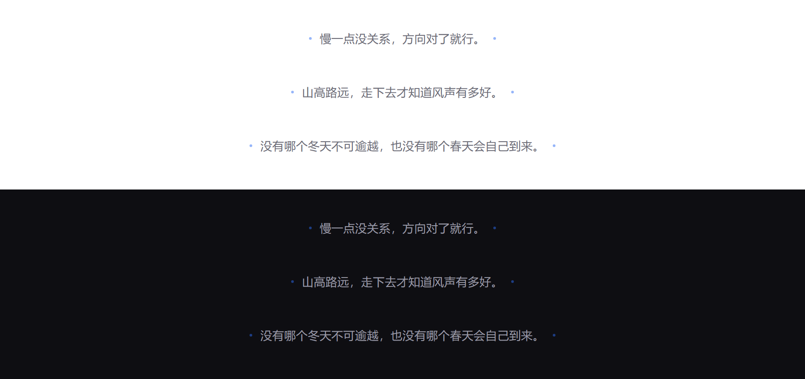
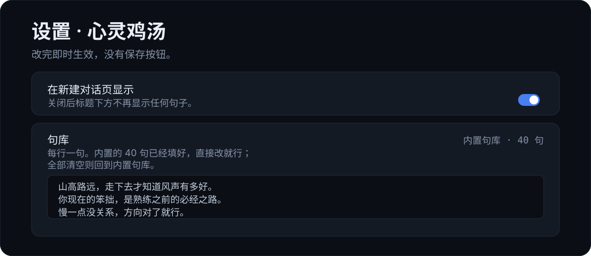

<p align="center">
  
</p>

**心灵鸡汤**：每次在 DSH 里新建对话，在「探索未至之境」标题下方显示一句不重复的鼓励。句子可以自己改。

<p align="center">
  
</p>

这段预览就是插件的真实输出——组件本身加它自己的样式表，在浏览器里按 2 倍渲染，三句都是内置句库里的原句。

## 它做什么

- **位置**：`探索未至之境` 标题正下方、`选择工作区` 上方。
- **换句**：每次新建对话抽一句；点这一行也能立刻换。
- **不重复**：牌堆是一段持久化的洗牌序列，一轮 40 句不重复，跨轮也不会连着重复同一句。
- **两种语言**：内置 40 句中文和 40 句英文，跟随界面语言。
- **可以改**：设置里能关掉它，也能把句库换成自己写的。
- **安静**：只在真正空白的会话里出现。会话一有内容、或正在跑、或还在加载，这一行就消失。

## 安装

包是私有的（`"private": true`），没有发布到 npm，按本地目录安装：

1. 克隆本仓库。
2. 在 DSH 里让 agent 执行插件管理器的 `install_bundle`，目标填克隆下来的目录绝对路径，例如 `<克隆目录>/dsh-hero-inspiration`。
3. 安装会把这个目录以 `link:` 的方式写进当前 profile 的依赖项和 `dsh.profile.bundles`。
4. 装好后新开或刷新页面，新建对话就能看到。

卸载：在「设置 → 插件」里停用或移除 `dsh-hero-inspiration`。

## 自定义

设置 → **心灵鸡汤**：

<p align="center">
  
</p>

- **在新建对话页显示** —— 关掉后标题下方不再出现任何句子。
- **句库** —— 每行一句。文本框里预填的就是内置的 40 句，直接在原文上改；全部清空则回到内置句库。

改动写进浏览器的 `localStorage`，下一次抽句就生效，没有保存按钮。空行会被丢掉，行内连续的空白会合成一个空格；单句最多 200 字，整库最多 200 句。

> 配置存在浏览器里（`dsh-hero-inspiration:config:v1`），换浏览器或清缓存会丢。

## 它是怎么做的

### 这一行为什么落在标题下方

空会话的 hero 里，composer 那一列的元素顺序是：标题块 → 工作区行 → `conversation.input.dock` 出口 → composer 卡片。插件注册在 `conversation.input.dock` 上，而这个槽的出口是 `display: contents`，于是这一行会成为同一列里的 flex item —— 只靠 `order` 就能落到标题下方、工作区上方：

```css
.dsh-hi { order: 1 }
*:has(> [data-slot="conversation.input.dock"] > .dsh-hi) > *:not(:first-child) { order: 2 }
```

三条排序规则都用 `:has(... > .dsh-hi)` 门控，只有这一行真的在屏幕上时才生效。会话有内容之后组件返回 `null`，列就回到出厂顺序，普通对话完全不受影响。

### 文字为什么在两个点中间

行本身是三轨网格：

```css
.dsh-hi { display: grid; grid-template-columns: 1fr auto 1fr; column-gap: 9px }
```

中间轨道正中，左右两条等分剩余空间，两个点各自贴住文字。渲染树严格是「点 | 按钮（里面只有文字）| 点」：按钮里多放任何不可见元素（比如一个 `opacity: 0` 的提示）都会把文字挤偏，这一点有测试守着。

### 牌堆

一串下标排列，存在 `localStorage` 的 `dsh-hero-inspiration:v1`：

```json
{ "order": [27, 3, 39, "…"], "cursor": 7, "last": 36 }
```

抽句时游标前进；走完一轮就重新洗牌，并保证新一轮的第一句不是屏幕上这句。句库长度变了（换成自定义句库），旧排列会因为长度对不上被丢弃重建。

配置在 `dsh-hero-inspiration:config:v1`：

```json
{ "enabled": true, "custom": [] }
```

`custom` 为空表示用内置句库（跟随界面语言）；非空则整库换成你自己的句子。

## 验证

```bash
npm test
```

四套检查，不需要安装任何依赖：

- `test/hero-inspiration.test.js` —— 在假的 React hooks 运行时里跑真实组件：40 句一轮不重复、连续新建不撞句、点击换句、五种应隐藏的场景、牌堆跨刷新续走、设置页的编辑与上限。
- `test/placement.test.js` —— 用真实的 hero DOM 结构解析插件注入的那段 CSS，验证「有这一行」和「没有这一行」两种排序结果。
- `test/centering.test.js` —— 15 组宽度下，文字中心恒等于行中心。
- `test/geometry.test.js` —— 在真实浏览器里量像素：文字中心与两点中点的偏差、左右间距。找不到 Chrome 或 Edge 时输出 `SKIP` 并以成功退出。

一次真实运行的节选：

```text
new sessions drawn: 41 / consecutive repeats: 0
distinct lines in the first 40 new sessions: 40
hidden for: session has content / prompt already attempted / conversation target active / turn running / session still loading
typed 3 lines; stored config: {"enabled":true,"custom":["第一句自定义",…]}
a 500-character line is clipped to 200 characters
320 pasted lines are capped to 200
reset refilled the box with the 40 built-in lines
with the line:    headline | the line | workspace row | composer card
without the line: headline | workspace row | composer card
centred layouts checked: 15 (text centre == row centre every time)
text vs dots mid   : 0.000 px
gap left / right   : 9.00 / 9.00 px
```

## 目录

```text
dsh-hero-inspiration/
├── index.js            Host 半，空的：这一行完全由浏览器半渲染
├── client.js           浏览器半：槽注册、样式、牌堆、设置页
├── cordis.patch.yml    插入一行 id 为 hero-inspiration 的插件行
├── locale/zh.json      插件列表里显示的名称与描述（另有 en.json）
├── icon.svg            插件图标
├── assets/readme/      README 用的图：hero.svg、settings.svg、preview.png
└── test/               上面四套检查
```

## 说明

- 这是纯浏览器半的插件：`dsh.client` 声明 `platform: web`，`index.js` 的 `apply()` 是空的，牌堆和配置都存在浏览器里，Host 侧没有状态。
- 只有会话处于空白新会话时这一行才出现，标题一闪而过是正常的。
- 仓库目前没有 `LICENSE` 文件。
